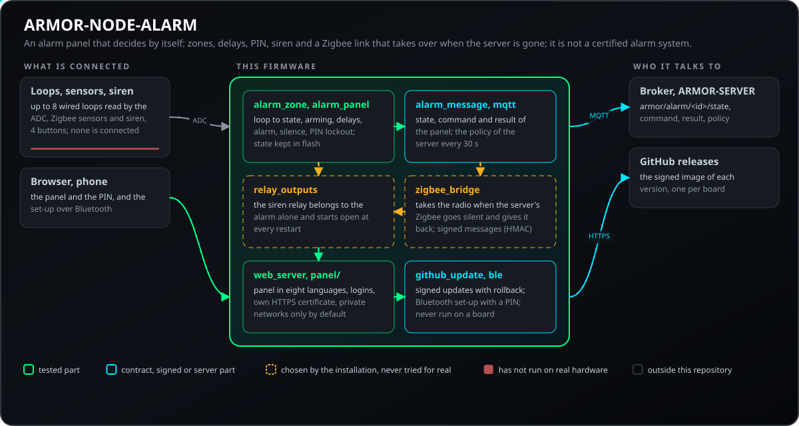
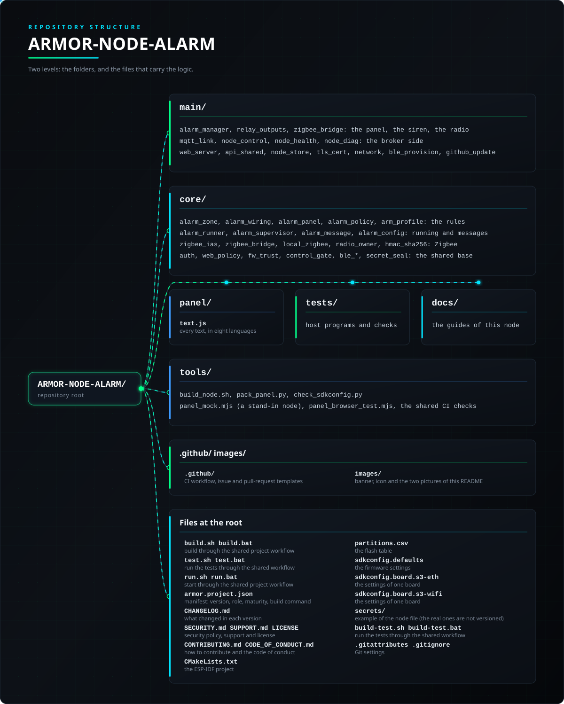

<p align="center">
  
</p>

# 🚨 ARMOR-NODE-ALARM

<p align="center">
  🇺🇸 <b>English</b> |
  <a href="README_spa.md">🇪🇸 Español</a> |
  <a href="README_fra.md">🇫🇷 Français</a> |
  <a href="README_ita.md">🇮🇹 Italiano</a> |
  <a href="README_deu.md">🇩🇪 Deutsch</a> |
  <a href="README_zho.md">🇨🇳 简体中文</a> |
  <a href="README_jpn.md">🇯🇵 日本語</a> |
  <a href="README_por.md">🇵🇹 Português</a>
</p>

### Alarm node and panel: the zones, the arming, the delays, the siren and the PIN of the house's alarm, with the firmware of the node and the rules tested on a computer (nothing has run on a board)

<p align="center">
  
  
  
  
  
  
  
</p>

---

**Honesty check - what runs today:** What exists is the **core of the alarm** (what a zone is, how a wired loop read by the ADC becomes a state, the panel's rules: arming, delays, the alarm, the siren, the PIN with lockout) and the **firmware of the node** built on it (settings, web panel, messages with the server, the Zigbee radio's bridge, a Zigbee coordinator on the network, relays, Bluetooth, signed updates), which builds for both boards; the core, the settings, the messages and the panel in a real browser against a stand-in node are tested on a computer with 488,930 checks in 18 test programs. **Nothing has run on a board or on a real installation, no zone has been wired and no siren connected, the node's own Zigbee conversation with a coordinator (local or on the network) is written and tested against a stand-in coordinator but has never run against a real coordinator or a real sensor, and this is not a certified alarm system.**

---

## 📋 At a glance

| | |
|---|---|
| Version | `0.4.9` |
| Maturity | Functional |
| Role | Alarm panel field node for ESP32-S3 (family: Field Nodes, parent: ARMOR-COMMON) |
| Stack | C++17, ESP-IDF 5.5.5, ESP32-S3 |
| Tests | 488930 checks in 18 host programs and 5 Python checks (`ctest`) |
| Inputs | Up to 8 wired loops, Zigbee sensors (IAS Zone) and siren (IAS WD), 4 buttons |
| Runs on | An ESP32-S3 board (Ethernet or Wi-Fi) with the base board; host tests on any computer |
| On real hardware | None yet: no board, zone, siren or Zigbee coordinator connected (host tests, the build and the panel in a browser only) |
| License | GPL-3.0-or-later |

**Jump to:** [Overview](#-overview) · [Architecture](#-architecture) · [Security](#-security--safety) · [Interfaces](#-interfaces) · [Configuration](#-configuration) · [Quick start](#-quick-start) · [Testing](#-testing) · [Troubleshooting](#-troubleshooting) · [Structure](#-repository-structure) · [Related](#-related-projects)

## 🚦 Project status

Each line is one part of this repository and the light says how far it is today. It is written from what the repository can show (tests, builds, runs), not from what is planned.

🟢 Done and verified · 🟡 Works, with known limits · 🟠 Partly done or not verified yet · 🔴 Not done or not working

| Area | State | What it means here |
|---|---|---|
| Software | 🟢 | The firmware builds in the ESP-IDF 5.5.5 container for both boards (Wi-Fi and Ethernet). |
| Tests | 🟢 | 488,930 checks in 18 host programs pass (`ctest`): the zones, the wired loops read by the ADC, the arming, delays, siren and PIN rules, the settings and the messages. |
| Protocols and data | 🟠 | The node's own Zigbee conversation with a coordinator, local or on the network, is tested only against a stand-in coordinator; it has never met a real coordinator or sensor. |
| Interface | 🟡 | The web panel is exercised in a real browser against a stand-in node, not on a board. |
| Hardware | 🔴 | No board built, no zone wired and no siren or Zigbee coordinator connected: nothing has run on a real installation. |
| Security | 🟡 | The PIN with lockout, the set-up code, the login limit and the signed updates are tested on the host; there has been no independent review and this is not a certified alarm system. |
| Updates | 🟠 | The hash and Ed25519 signature checks and the rollback logic pass on the host; an update over the air has never been run on a board. |
| Writing to equipment | 🟠 | The siren and the relays are driven by the alarm rules and tested against stand-ins; none has been connected to a real siren or relay. |
| Integration | 🟠 | The messages of the node are validated against the shared schemas and conformance vectors of ARMOR-COMMON. Its MQTT client is played against a real Mosquitto in the tests; no board has sent them to a server yet. |
| Documentation | 🟢 | Eight languages, the firmware guide, the wiring notes and the changelog are up to date. |

## 🎯 Overview

* **Zones:** four kinds - *instant* (a door, a window), *entry* (the door you come in through: it starts the entry delay), *interior* (motion: only in "away") and *always* (smoke, gas, panic: armed or not). A zone may be a wired loop or a Zigbee sensor.
* **The wired loop:** a contact with an end-of-line resistor, read as a voltage, gives four states in one pin - normal, triggered, and tamper for a shorted or a cut wire. The limits are settings; a debouncer keeps a bouncing contact from raising the alarm.
* **The panel:** *away* and *stay* arming, an exit delay that does not treat the person leaving as an intruder, an entry delay, an alarm that **latches** until a correct disarm, a siren that stops by itself after a time, bypass of open zones when forced (never a sounding smoke detector), and a log of the last hundred events.
* **The PIN:** arming needs none, disarming and silencing do; wrong PINs are counted and, after a few, everything is refused for a while, even the right PIN.
* **Silence without disarming:** while the siren sounds, a correct PIN stops it at once with the system still armed - the alarm stays latched and recorded, a zone that has not sounded yet may sound it again, and a wrong PIN counts toward the lockout like a wrong disarm PIN.
* **The plan:** a gateway on the electrical node's board (a Zigbee radio, wired zones, a siren relay) that works with ARMOR-SERVER and **keeps guarding when the server is away**: a panel takes the radio over from the server through the Zigbee bridge of ARMOR-NODE-ELECTRICAL. See [the design](docs/DESIGN.md) and [the failover](docs/FAILOVER.md).
* **The node:** firmware for the ESP32-S3 (PoE Ethernet or Wi-Fi) with up to eight wired zones, the siren on a relay, the web panel of every node in eight languages, the Zigbee radio lent to Zigbee2MQTT, and the messages `armor/alarm/<node>/state|command|result`; the server may arm and disarm only when three independent switches allow it. See [the firmware](docs/NODE_FIRMWARE.md), [the messages](docs/ALARM_MESSAGES.md) and [the hardware](docs/HARDWARE.md).
* **Taking the radio over:** after the server's Zigbee2MQTT has been away for a set time the node brings the coordinator up itself (ZNP), reads the sensors of the zones that name one (IAS Zone) and commands Zigbee sirens (IAS WD), and lets go the moment the client returns.
* **Not yet:** a real coordinator or sensor, the hardware and any test on a real installation.
* **A restart does not disarm the house:** the mode, a running alarm and the zones left out are kept in flash and taken back at start; a cut or shorted loop is never left out; messages go through a queue (no deadlock with the broker) and the watchdog restarts the board if the task that reads the zones stops.
* **Signed over-the-air updates:** the node installs from GitHub only an image whose SHA-256 matches and that carries a valid Ed25519 signature of the maintainer (the public key is in the firmware, the private one never leaves the maintainer); a file uploaded by hand by an administrator in the panel is still accepted. The pages and messages of the panel are in eight languages.
* **Bluetooth pairing with a PIN:** the six-digit PIN is derived from the set-up code, printed on the USB console and shown to an administrator in the panel; the phone has to enter it before it may write the node's settings.
* **Siren and restarts:** the siren's relay belongs to the alarm alone (the broker, the central and the panel cannot move it, and it does not fall back to open when the broker is lost); a zone that has not sounded yet sounds the siren again after it timed out; an alarm of smoke or panic with the system disarmed, a silenced alarm and a lockout come back after a restart; a reset by hand is refused while the alarm is armed; a Zigbee sensor that never speaks counts as lost.
* **Only the house may use the panel:** the panel answers the private network by default (or the networks its owner lists, such as a VPN), refuses a list that would lock out whoever saves it, counts wrong passwords for each person as well as each address, and works behind the server's proxy so that it can be reached from outside the house without publishing the node.
* **A zone that cannot be read is not shown as closed:** if the converter does not start or a loop gives no reading for five rounds in a row, the zone is in *trouble* - it is not guarding, it never sounds the siren, it stops an arming (unless forced, and then it is left out and noted) and the server warns.
* **Optional encrypted link to the broker (TLS):** off by default, so the node talks plain MQTT as before. A switch and a box for the certificate of the installation's own authority (PEM, at most 2 KB) in the Broker page make it connect with `mqtts://`, trust that authority only and check that the broker's certificate was made for the address it reached; anything that is not one PEM certificate is refused. Covered by host tests; the handshake has not been run on a board yet.
* **Arming profiles:** an arm command may carry a profile (Away, Home, Night, your own) that chooses, for that arming, which zones guard, which alarm at once or after the entry delay, the exit and entry delays and whether the siren sounds (a silent alarm is still latched, recorded and told). It never touches smoke, panic or tamper zones, the PIN, the lockout, the silence, a forced arming or a zone in trouble; the profile survives a restart, and an arm without one behaves exactly as before. Tested against the old rules with a random run and against the shared contract.
* **Health report:** about once a minute the node publishes how long it has been up and why it last restarted, its free memory, its link and Wi-Fi signal, how many times it connected to the broker and the last error it logged (`armor/health/<node>`, the `node_health` contract of ARMOR-COMMON). The code that builds it is shared by every node and tested on a computer; it has not run on a board.
* **Control from the server:** Studio can restart the node cleanly, pause it for up to an hour (it resumes by itself), put its work in standby (no end, kept across restarts, the node stays connected and keeps answering), make it show itself, ask for a diagnostics snapshot and mark it as in maintenance (`armor/control/<node>/...`, the `node_control` contract of ARMOR-COMMON). Every order takes two steps with a one-time token that belongs to that operation, only the server may write them on the broker, and there is no factory reset, no erase and no deep sleep. While the node is paused or in standby its zones are not read, nothing is evaluated, armed or sounded, no state is published and the siren relay is held open: the house is NOT protected, and the health report says so. The code is shared by every node and tested on a computer; it has not run on a board.
* **Diagnostics without a cable:** after a start that was not clean (a crash, a watchdog, a sag of the supply, a failed allocation) the health report says why for ten minutes; a crash leaves its core dump to look at, download or erase from the panel; the stored settings are copied before every firmware install and recovered if an update damages them; and an administrator can ask the node, through the server, for a diagnostic package or its log with a one-time token.
* **The server's security options:** the panel applies the options the server keeps for it (`armor/alarm/<node>/policy`) and each can be fixed on the node itself: the saved armed state is tied to the zones and the PIN, the server's Zigbee zone messages can be switched off, and when signed they are checked (signature with a key typed in the panel, and a sequence number that only goes up). Tested on a computer against the values the contract and the server compute; not run on a board.
* **Optional sealing of stored secrets:** off by default (`security.seal_secrets`, or the server's `nodes.nvs_encryption`). When on, the passwords, tokens, keys, PINs and password hashes the node stores are kept sealed with ChaCha20-Poly1305 and everything else stays readable; turning it on or off rewrites them with nothing lost, even if the node stops half-way. No eFuse is burned and the flash is not encrypted: the key lives in a partition of the same chip, so it does **not** protect against someone who holds the board, and a node installed before that partition existed keeps its secrets as they were until it is flashed with the new partition table.

## 🧩 Role in A.R.M.O.R.

ARMOR-NODE-ALARM is the alarm panel: the zones, the arming, the delays, the siren and the PIN are decided on the node itself, so the house is still guarded when the server is away. [ARMOR-SERVER](https://github.com/JuanenRac/ARMOR-SERVER) shows it, ties Zigbee sensors to its zones and, when you allow it, arms and disarms it; the *Alarm panels* menu and the *Alarm Designer* of [ARMOR-STUDIO](https://github.com/JuanenRac/ARMOR-STUDIO) and the [ARMOR-ANDROID-CONTROL](https://github.com/JuanenRac/ARMOR-ANDROID-CONTROL) app drive it. Its Zigbee radio can be on the board or a coordinator on the network.

| Name | How | What for |
|---|---|---|
| ARMOR-SERVER | MQTT `armor/alarm/<id>/{state,command,result,zigbee,policy}` | Receives the state of the panel; orders arming, disarming and silencing only behind three switches |
| ARMOR-STUDIO | alarm panels menu | Shows the zones, the events and the policy, and opens the node's panel |
| ARMOR-ANDROID-CONTROL | Bluetooth | Sets the node up in the field and shows the alarm panels |
| ARMOR-COMMON | alarm contract | The messages are checked against its schemas; the common firmware is copied from it |

## 🏛️ Architecture

<p align="center">
  
</p>

## 🖼️ Screenshots

Captured at 1920×1080 on a test bench, with sample data and no real installation behind them.

<table>
<tr><td width="50%" valign="top"><br><sub>Overview: the state of the node at a glance - network, broker, firmware and what it reports.</sub></td><td width="50%" valign="top"><br><sub>Zones: each wired or Zigbee zone of the panel, its kind, hold time and live state.</sub></td></tr>
<tr><td width="50%" valign="top"><br><sub>Zigbee radio: the serial bridge to the coordinator module, which client may use it, and the state of the bridge.</sub></td><td width="50%" valign="top"><br><sub>Relays and siren: the outputs of the base board and what drives each one.</sub></td></tr>
</table>

## 🔒 Security & Safety

| Threat | Defence |
|---|---|
| Passwords in clear or compiled in | PBKDF2-HMAC-SHA256 with 10 000 rounds; no password in the firmware (a node with no user enters set-up); at most 4 users (admin or viewer) and 8 to 64 characters; at most 6 sessions, 30 minutes idle |
| Taking a freshly flashed node | Set-up needs a start-up code: the one of the build (`CONFIG_ARMOR_SETUP_CODE`) or a random one kept in flash and shown on the USB console; with a fleet secret it is `HMAC-SHA256(secret, MAC)`; it is also the key of the set-up Wi-Fi (WPA2, never bridged) |
| The panel reached from the internet | It answers the private networks of a house by default (10/8, 172.16/12, 192.168/16, 169.254/16, 127/8 and 100.64/10 where some VPNs live); the setting `web.admin_sources` lists other IPv4 addresses and networks (8 entries, 120 characters); anything outside is refused except the public identity `GET /api/v1/session`; a list that would lock out the person saving it is rejected |
| The panel in clear over HTTP | HTTPS on 443 with a certificate the node makes itself (self-signed, in flash, SHA-256 fingerprint shown to compare); the panel can be http, https or both; the session cookie is always HttpOnly and SameSite=Strict (and Secure over TLS) |
| A fake firmware from GitHub | An image is installed only with a matching SHA-256 and a valid Ed25519 signature made with the maintainer's key (`no_checksum`, `no_signature`, `bad_signature`, `checksum_mismatch`, `wrong_firmware`, `not_newer`, `version_mismatch` refuse it); a manual upload by an administrator is not checked: an explicit limit |
| Hijacking the Bluetooth set-up | A 6-digit PIN derived from the set-up code, shown on the USB console and to an administrator; the phone must type it before writing settings; the set-up window lasts `CONFIG_ARMOR_BLE_SETUP_MINUTES` (10 by default, 1 to 120) |
| Stored secrets read by someone who has the board | Optional (off by default, switch `security.seal_secrets` or the server's `nodes.nvs_encryption`): ChaCha20-Poly1305 for passwords, tokens, keys, PINs and hashes. It does not encrypt the flash or burn an eFuse: the key is in a partition of the same chip, so it does not protect against whoever holds the board |
| The broker link in clear | Optional TLS (`mqtts://`) with the owner's own authority (PEM up to 2 KB) and a check of the name; off by default. The handshake has only run in host tests, not on a board |
| Guessing the panel PIN | The comparison does not leak where it differs; failures in a row lock the panel for `lockout_s` (60 s by default, 1 to 3600) times 1, 5 and 15 for the first three lockouts, even for the right PIN; a lockout in progress is restored after a restart; arming needs no PIN, disarming and silencing do |
| A restart that disarms the house | The mode, the alarm in progress and the excluded zones are kept in flash and recovered; a cut or shorted loop is never left out; smoke, panic and tamper that fired while disarmed come back after a restart; the BOOT reset only erases with the panel DISARMED |
| A zone that cannot be read looks closed | It shows `trouble` (the converter does not start or 5 rounds gave no reading) and the panel does not arm with it unless forced, and then it is excluded and noted; a smoke or panic detector that is sounding is never excluded |
| An order from the server that nobody authorised | Arming, disarming and silencing from the server need THREE switches (the node setting, the broker's access list and `ARMOR_ALARM_COMMANDS=1` on the server), the server asks the user's PIN before sending a disarm or a silence, and all of it is off by default; the siren relay belongs to the alarm alone (the broker, the central and the panel cannot move it) |
| Forged Zigbee messages | The topic `armor/alarm/<id>/zigbee` carries an HMAC-SHA256 over node, zone, state, battery and sequence with the panel's key (64 hex typed in the panel), and the sequence only goes up; the policy topic carries `config_hash`, `zone_feed` and its signature, each of which can be pinned on the node |

This is not a certified alarm system ([docs/SAFETY.md](docs/SAFETY.md)): it is a home project and has never run on a board or in a real installation. If the server is gone the panel decides alone, and if the node or its radio also fails nobody is watching. Read [SECURITY.md](SECURITY.md) to report a vulnerability.

## 🔌 Interfaces

| Part | What it sets |
|---|---|
| MQTT | `armor/alarm/<id>/state` (not retained: zones with id, name, kind, state and bypass, the phase), `/command`, `/result`, `/zigbee` and `/policy` (server to panel); `armor/device/<id>/<relay>/{state,set}`, `armor/health/<id>`, `armor/control/<id>/...` |
| Zones | Kind `instant`, `entry`, `interior` or `always`; state `normal`, `triggered`, `tamper` or `trouble`; up to 8 wired loops (a contact with an end-of-line resistor read by the ADC gives four states on one pin; the Ethernet board has 6 valid analogue pins, the Wi-Fi board 8), 4 buttons and a log of 100 events |
| Zigbee | A serial bridge (ZNP) to a coordinator, IAS Zone sensors and IAS WD sirens; the node takes the radio when the server's Zigbee2MQTT goes silent for `zigbee_silence_min` and gives it back when the server returns ([docs/ZIGBEE.md](docs/ZIGBEE.md), [docs/FAILOVER.md](docs/FAILOVER.md)) |

## ⚙️ Configuration

| Variable | Default | What it sets |
|---|---|---|
| `panel.exit_delay_s`, `panel.entry_delay_s` | 30, 30 (0-600) | The exit and entry delays; the exit does not treat the person leaving as an intruder |
| `panel.lockout_s` | 60 (1-3600) | The PIN lockout, times 1, 5 and 15 for the first three |
| `zigbee_silence_min` | - | How long the server's Zigbee may be silent before the node takes the radio |
| `CONFIG_ARMOR_NODE_ID`, `_SETUP_CODE`, `_FLEET_SECRET`, `_MQTT_*`, `_HEARTBEAT_S`, `_BLE_SETUP_MINUTES`, `_BOOT_FACTORY_RESET` | - | The settings every node shares: the name (empty gives `armor-` and the last bytes of the MAC), the set-up code (empty: random), the fleet secret (16+ characters, never in the repository), the first broker settings, the heartbeat (2 to 300 s), the minutes of Bluetooth set-up (1 to 120) and the reset with BOOT (8 s in the first 30 s) |

Re-sounds after a silence are limited to 3 (`kMaxResounds`). The siren relay starts open on every restart and does not fall open when the broker is lost.

## 🚀 Quick start

**Requirements:** a C++17 compiler for the host tests; the ESP-IDF 5.5.5 container to build the image; an ESP32-S3 board (Ethernet or Wi-Fi) with the base board.

```bash
cmake -S tests -B build/host && cmake --build build/host && ctest --test-dir build/host   # host tests, -Werror
node tools/panel_mock.mjs --user admin:adminpass123   # the panel without a board
tools/build_node.sh generic s3-wifi                  # the image in the ESP-IDF container (or s3-eth)
```

See the [design](docs/DESIGN.md), [how the panel takes over from the server](docs/FAILOVER.md) and the [safety notes](docs/SAFETY.md).

## 🧪 Testing

```bash
cmake -S tests -B build/host && cmake --build build/host && ctest --test-dir build/host
python -I tools/armor_ci_validate.py
```

18 host test programs and 5 Python checks run under `ctest`; 488930 checks counted by the host programs, built with `-Werror`.

Python checks: the panel texts in eight languages, the tasks, the save paths, the Bluetooth session under its lock and the routes the panel calls (and, in some nodes, the HTTP codes or the glyphs of the fonts)

The host tests need any C++17 compiler (Linux, WSL, MSYS2); the web panel is also exercised in a real browser against a stand-in node (`tools/panel_mock.mjs`, `tools/panel_browser_test.mjs`).

Most of the checks are exhaustive sweeps of the panel rules; the loops, the siren and the Zigbee link are stand-ins.

## 🏗️ Build & Release

`tools/build_node.sh` builds the image in the ESP-IDF 5.5.5 container and the release carries the image, its SHA-256 and its Ed25519 signature, one per board; the image is written by USB-C the first time and updated from the panel afterwards.

## 🩺 Troubleshooting

| You see | Because | Do |
|---|---|---|
| You lost the password or the node no longer joins the network | A node with set-up and no address after 90 s opens its own Wi-Fi `ARMOR-SETUP-xxxxxx` (open `http://192.168.4.1/`) | To start again hold BOOT for 8 seconds in the first 30 seconds after power-up (erases settings and users), or use *Factory reset* in the panel |
| An update from GitHub is refused | The release has no checksum or signature, they do not match (`e_no_checksum`, `e_no_signature`, `e_checksum_mismatch`, `e_bad_signature`), has no image for this board (`e_no_asset_for_board`) or is for another project (`e_wrong_firmware`) | Nothing changed on the node; try again or let an administrator upload the file by hand |
| The panel will not arm | A zone is in `trouble` (the converter does not start or 5 rounds gave no reading) | Fix the wiring, or force the arming (the zone is then excluded and noted) |
| The PIN is refused even when it is right | The panel is locked after failed attempts (even the right PIN is refused) | Wait `lockout_s`; the lockout survives a restart |
| The BOOT reset does nothing | The panel is armed: the reset only erases a disarmed panel | Disarm with the PIN first |

## 📂 Repository Structure

<p align="center">
  
</p>

<details>
<summary>Text version of the tree</summary>

```text
ARMOR-NODE-ALARM/
├── main/                                the firmware: an ESP-IDF component
├── core/                                the logic with no ESP-IDF, tested on a computer
├── panel/                               the web panel embedded in the firmware
├── tests/                               host tests and Python checks
├── docs/                                11 guides: safety, messages, Zigbee, failover
├── tools/                               build, pack and check tools
├── .github/                             CI workflow, issue and pull-request templates
├── images/                              banner, icon and the two pictures of this README
├── build.sh build.bat                   build through the shared project workflow
├── test.sh test.bat                     run the tests through the shared workflow
├── run.sh run.bat                       start through the shared project workflow
├── armor.project.json                   manifest: version, role, maturity, build command
├── CHANGELOG.md                         what changed in each version
├── SECURITY.md SUPPORT.md LICENSE       security policy, support and license
├── CONTRIBUTING.md CODE_OF_CONDUCT.md   how to contribute and the code of conduct
├── CMakeLists.txt                       the ESP-IDF project
├── partitions.csv                       the flash table
├── sdkconfig.defaults                   the firmware settings
├── sdkconfig.board.s3-eth               the settings of one board
├── sdkconfig.board.s3-wifi              the settings of one board
├── secrets/                             example of the node file (the real ones are not versioned)
├── build-test.sh build-test.bat         run the tests through the shared workflow
└── .gitattributes .gitignore            Git settings
```

</details>

## 🗺️ Roadmap & Known limits

**Known limits today**

* The node's own Zigbee conversation with a coordinator, local or on the network, is tested only against a stand-in coordinator; it has never met a real coordinator or sensor.
* The web panel is exercised in a real browser against a stand-in node, not on a board.
* No board built, no zone wired and no siren or Zigbee coordinator connected: nothing has run on a real installation.
* The PIN with lockout, the set-up code, the login limit and the signed updates are tested on the host; there has been no independent review and this is not a certified alarm system.
* The hash and Ed25519 signature checks and the rollback logic pass on the host; an update over the air has never been run on a board.
* The siren and the relays are driven by the alarm rules and tested against stand-ins; none has been connected to a real siren or relay.

**Next**

* Wire real loops and a siren, try the Zigbee link with a real coordinator and sensors, and run the panel in a real installation before anything more is claimed.

## 🌍 Languages

README and texts exist in English, Spanish, French, Italian, German, Chinese, Japanese and European Portuguese.

## 🔗 Related Projects

**A.R.M.O.R.** (Autonomous Radar & Multimodal Observation Range) is a perimeter-security system made of independent repositories. Each one has its own version, its own tests and its own README; this is the family:

* **[ARMOR-COMMON](https://github.com/JuanenRac/ARMOR-COMMON)** - Message contracts, validators, conformance vectors and generated types
* **[ARMOR-NODE-RADAR](https://github.com/JuanenRac/ARMOR-NODE-RADAR)** - Field-node firmware for ESP32-S3 with three radars and its own web panel
* **[ARMOR-NODE-SOLAR](https://github.com/JuanenRac/ARMOR-NODE-SOLAR)** - Solar inverter and battery protocols and the messages of a gateway node
* **[ARMOR-NODE-ELECTRICAL](https://github.com/JuanenRac/ARMOR-NODE-ELECTRICAL)** - Electrical node: meters, the message of the network's readings and the rules for switching
* **ARMOR-NODE-ALARM** (this repository) - Alarm node and panel: zones, arming, delays, siren and PIN, with the server or without it
* **[ARMOR-NODE-HMI](https://github.com/JuanenRac/ARMOR-NODE-HMI)** - Touch panel: the state of the system on a wall screen, arming and acknowledging, and the home of the voice assistant
* **[ARMOR-NETWORK](https://github.com/JuanenRac/ARMOR-NETWORK)** - The local network: its devices, the internet and what changes
* **[ARMOR-SERVER](https://github.com/JuanenRac/ARMOR-SERVER)** - Central coordinator: telemetry, alarms, devices, solar readings and cameras
* **[ARMOR-STUDIO](https://github.com/JuanenRac/ARMOR-STUDIO)** - Web console: cameras, radar, alarms, solar energy and the 2D/3D site designer
* **[ARMOR-ANDROID-CONTROL](https://github.com/JuanenRac/ARMOR-ANDROID-CONTROL)** - Android operator client with a live 2D/3D radar
* **[ARMOR-IOS-CONTROL](https://github.com/JuanenRac/ARMOR-IOS-CONTROL)** - iPhone operator client
* **[ARMOR-SERVER-AI](https://github.com/JuanenRac/ARMOR-SERVER-AI)** - Visual inference policy that explains its decisions and never actuates
* **[ARMOR-VISION](https://github.com/JuanenRac/ARMOR-VISION)** - Camera zones, masks and detection rules for the Jetson Orin NX
* **[ARMOR-VOICE-AI](https://github.com/JuanenRac/ARMOR-VOICE-AI)** - Offline voice intents with a confirmation that cannot be forged
* **[ARMOR-HARDWARE](https://github.com/JuanenRac/ARMOR-HARDWARE)** - Enclosures, electronics and the bench acceptance matrix
* **[ARMOR-DEVOPS](https://github.com/JuanenRac/ARMOR-DEVOPS)** - Deployment, the CM5 test bench, backup and TLS
* **[ARMOR-SIMULATOR](https://github.com/JuanenRac/ARMOR-SIMULATOR)** - Offline telemetry simulator with repeatable faults
* **[ARMOR-UPDATER](https://github.com/JuanenRac/ARMOR-UPDATER)** - Detects, installs and updates the ecosystem's own repositories
* **[ARMOR-DOCS](https://github.com/JuanenRac/ARMOR-DOCS)** - Architecture, security baseline and the capability matrix

## 📚 Documentation

* [Safety](docs/SAFETY.md): what the panel promises and what it does not
* [Alarm messages](docs/ALARM_MESSAGES.md), [Zigbee](docs/ZIGBEE.md) and [failover](docs/FAILOVER.md)
* [Design](docs/DESIGN.md), [hardware](docs/HARDWARE.md), [base board](docs/BASE_BOARD.md) and [node firmware](docs/NODE_FIRMWARE.md)
* [Bench tests](docs/BENCH_TESTS.md), [set-up code](docs/SETUP_CODE.md) and [Bluetooth provisioning](docs/BLE_PROVISIONING.md)
* [Capability matrix: what is proven and what is not](https://github.com/JuanenRac/ARMOR-DOCS/blob/main/docs/CAPABILITY_MATRIX.md)
* [Project catalogue: versions and how the repositories depend on each other](https://github.com/JuanenRac/ARMOR-DOCS/blob/main/docs/PROJECT_CATALOG.md)
* [Changelog of this repository](CHANGELOG.md)

## 🤝 Contributing & Community

* Before a pull request run `ctest --test-dir build/host` and `python -I tools/armor_ci_validate.py`: it must pass. See [CONTRIBUTING.md](CONTRIBUTING.md) and the [code of conduct](CODE_OF_CONDUCT.md).
* The README exists in eight languages and is generated from the sources in ARMOR-DOCS: a change to the text is made there.
* A change to a message between components starts in ARMOR-COMMON.
* Do not describe as working on a board what has only been built.
* Report a vulnerability privately: [SECURITY.md](SECURITY.md). Questions, ideas and reports: electrohobby3d@gmail.com ([SUPPORT.md](SUPPORT.md)).

## 👤 AUTHOR

**JuanenRac (Electro Hobby 3D)** · electrohobby3d@gmail.com

## 📜 LICENSE

GPL-3.0-or-later - see [LICENSE](LICENSE).
