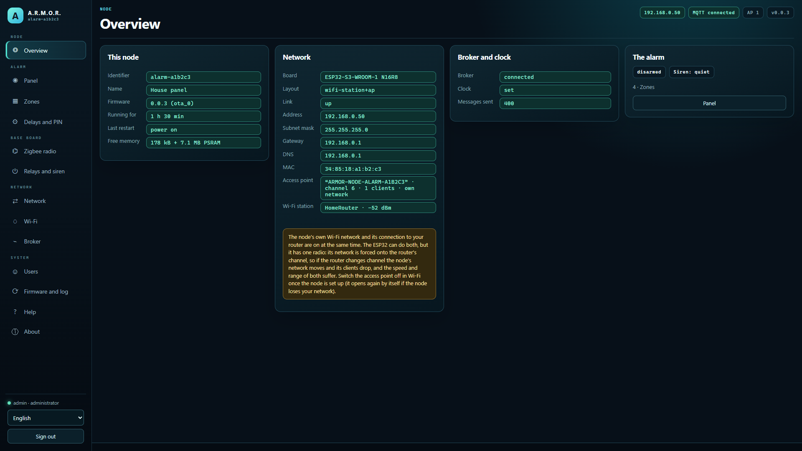
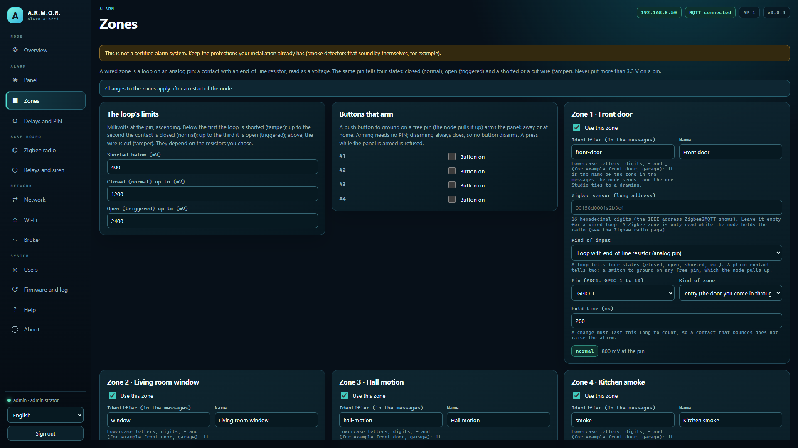
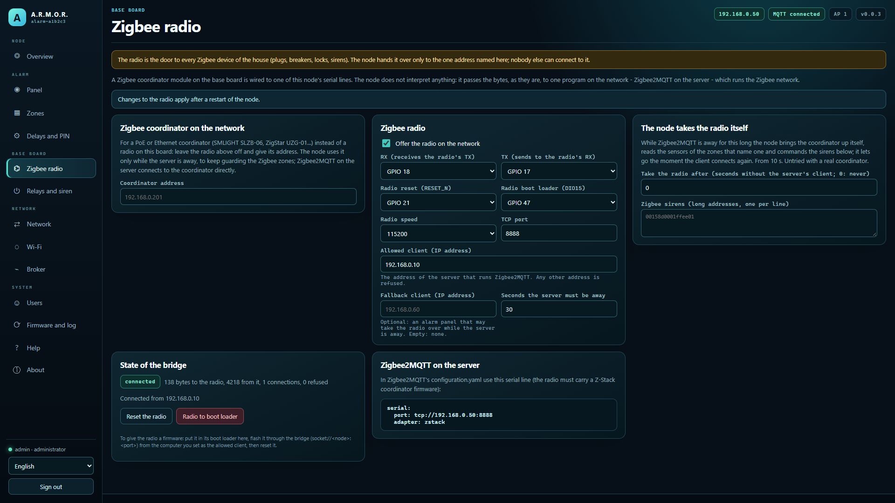
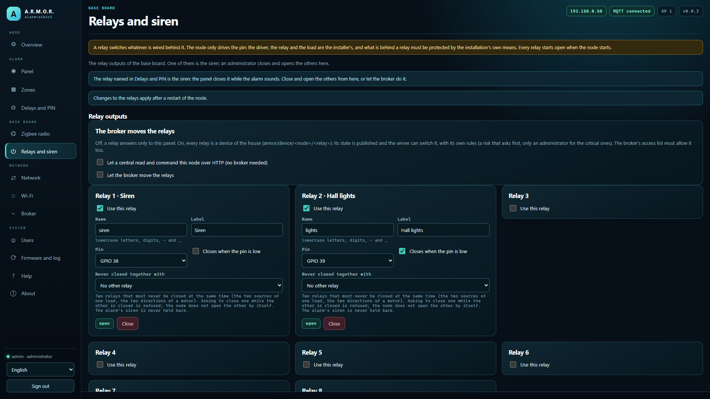

<p align="center">
  
</p>

# 🚨 ARMOR-NODE-ALARM

<p align="center">
  <a href="README.md">🇺🇸 English</a> |
  <a href="README_spa.md">🇪🇸 Español</a> |
  <a href="README_fra.md">🇫🇷 Français</a> |
  🇮🇹 <b>Italiano</b> |
  <a href="README_deu.md">🇩🇪 Deutsch</a> |
  <a href="README_zho.md">🇨🇳 简体中文</a> |
  <a href="README_jpn.md">🇯🇵 日本語</a> |
  <a href="README_por.md">🇵🇹 Português</a>
</p>

### Nodo e centrale d'allarme: le zone, l'inserimento, i ritardi, la sirena e il PIN dell'allarme di casa, con il firmware del nodo e le regole provate su un computer (nulla ha girato su una scheda)

<p align="center">
  
  
  
  
  
  
</p>

---

**Controllo di onestà - cosa funziona oggi:** Ciò che esiste è il **nucleo dell'allarme** (cos'è una zona, come un anello cablato letto dall'ADC diventa uno stato, le regole della centrale: inserimento, ritardi, l'allarme, la sirena, il PIN con blocco) e il **firmware del nodo** costruito su di esso (impostazioni, pannello web, messaggi con il server, il ponte della radio Zigbee, un coordinatore Zigbee in rete, relè, Bluetooth, aggiornamenti firmati), che si compila per entrambe le schede; il nucleo, le impostazioni, i messaggi e il pannello in un vero browser contro un nodo sostitutivo sono provati su un computer con 486.690 controlli in 14 programmi di test. **Nulla ha girato su una scheda né su un impianto reale, nessuna zona è stata cablata né sirena collegata, la conversazione Zigbee del nodo con un coordinatore (locale o in rete) è scritta e provata contro un coordinatore sostitutivo ma non ha mai girato contro un coordinatore o un sensore reali, e questo non è un sistema d'allarme certificato.**

---

## 📋 In breve

| | |
|---|---|
| Versione | `0.4.8` |
| Maturità | Funzionale |
| Test | 486.690 controlli in 14 programmi (`ctest`) |
| Tecnologia | C++17 host-tested core; ESP-IDF 5.5.5 firmware for the ESP32-S3 (PoE Ethernet and Wi-Fi boards) |
| Su hardware reale | Ancora nessuno: nessuna scheda, zona, sirena o coordinatore Zigbee collegati (solo test su computer, la compilazione e il pannello in un browser) |

## 🚦 Stato del progetto

Ogni riga è una parte di questo repository e il semaforo dice a che punto è oggi. È scritta in base a ciò che il repository può mostrare (test, compilazioni, esecuzioni), non a ciò che è previsto.

🟢 Fatto e verificato · 🟡 Funziona, con limiti noti · 🟠 Fatto a metà o non ancora verificato · 🔴 Non fatto o non funzionante

| Area | Stato | Cosa significa qui |
|---|---|---|
| Software | 🟢 | Il firmware compila nel contenitore ESP-IDF 5.5.5 per entrambe le schede (Wi-Fi ed Ethernet). |
| Test | 🟢 | Superano 486.690 controlli in 14 programmi host (`ctest`): le zone, i circuiti cablati letti dall'ADC, le regole di inserimento, ritardi, sirena e PIN, le impostazioni e i messaggi. |
| Protocolli e dati | 🟠 | La conversazione Zigbee del nodo stesso con un coordinatore, locale o in rete, è provata solo contro un coordinatore simulato; non ha mai incontrato un coordinatore o un sensore reali. |
| Interfaccia | 🟡 | Il pannello web è stato provato in un browser reale contro un nodo simulato, non su una scheda. |
| Hardware | 🔴 | Nessuna scheda costruita, nessuna zona cablata e nessuna sirena o coordinatore Zigbee collegati: nulla ha funzionato su un impianto reale. |
| Sicurezza | 🟡 | Il PIN con blocco, il codice di configurazione, il limite di accessi e gli aggiornamenti firmati sono testati sull'host; non c'è stata una revisione indipendente e non è un sistema di allarme certificato. |
| Aggiornamenti | 🟠 | I controlli di hash e firma Ed25519 e la logica di ripristino passano sull'host; un aggiornamento via etere non è mai stato eseguito su una scheda. |
| Scrittura sulle apparecchiature | 🟠 | La sirena e i relè sono comandati dalle regole dell'allarme e provati contro simulazioni; nessuno è stato collegato a una sirena o a un relè reali. |
| Integrazione | 🟢 | I messaggi del nodo sono validati contro gli schemi condivisi e i vettori di conformità di ARMOR-COMMON. |
| Documentazione | 🟢 | Otto lingue, la guida del firmware, le note di cablaggio e il registro delle modifiche sono aggiornati. |

## 🎯 Panoramica

* **Zone:** quattro tipi - *istantanea* (una porta, una finestra), *d'ingresso* (la porta da cui si entra: avvia il ritardo d'ingresso), *interna* (movimento: solo in "fuori casa") e *sempre* (fumo, gas, panico: inserita o no). Una zona può essere un anello cablato o un sensore Zigbee.
* **L'anello cablato:** un contatto con resistenza di fine linea, letto come tensione, dà quattro stati su un solo pin - normale, scattato e manomissione per un filo in cortocircuito o tagliato. I limiti sono impostazioni; un filtro antirimbalzo impedisce che un contatto che rimbalza faccia scattare l'allarme.
* **La centrale:** inserimento *fuori casa* e *in casa*, un ritardo di uscita che non tratta da intruso chi esce, un ritardo d'ingresso, un allarme che **resta memorizzato** fino a un disinserimento corretto, una sirena che si ferma da sola dopo un po', l'esclusione delle zone aperte se si forza (mai un rilevatore di fumo che suona) e un registro degli ultimi cento eventi.
* **Il PIN:** l'inserimento non lo chiede, il disinserimento e il silenziamento sì; i PIN errati vengono contati e, dopo alcuni, tutto viene rifiutato per un po', anche il PIN giusto.
* **Silenziare senza disinserire:** finché la sirena suona, un PIN corretto la ferma subito con il sistema ancora inserito - l'allarme resta agganciato e registrato, una zona che non ha ancora suonato può farla suonare di nuovo, e un PIN errato conta per il blocco come uno errato di disinserimento.
* **Il piano:** un gateway sulla scheda del nodo elettrico (radio Zigbee, zone cablate, relè della sirena) che lavora con ARMOR-SERVER e **continua a sorvegliare quando il server manca**: una centrale prende la radio al server tramite il ponte Zigbee di ARMOR-NODE-ELECTRICAL. Vedi [il progetto](docs/DESIGN.md) e [il passaggio di consegne](docs/FAILOVER.md).
* **Il nodo:** firmware per l'ESP32-S3 (Ethernet PoE o Wi-Fi) con fino a otto zone cablate, la sirena su un relè, il pannello web di tutti i nodi in otto lingue, la radio Zigbee prestata a Zigbee2MQTT e i messaggi `armor/alarm/<nodo>/state|command|result`; il server può inserire e disinserire solo se tre interruttori indipendenti lo permettono. Vedi [il firmware](docs/NODE_FIRMWARE.md), [i messaggi](docs/ALARM_MESSAGES.md) e [l'hardware](docs/HARDWARE.md).
* **Prendere la radio:** quando Zigbee2MQTT del server è assente da un certo tempo, il nodo avvia da sé il coordinatore (ZNP), legge i sensori delle zone che ne nominano uno (IAS Zone) e comanda sirene Zigbee (IAS WD), e la rilascia appena il client torna. **Non ancora:** un coordinatore o sensore reali, l'hardware e qualsiasi prova su un impianto reale.
* **Un riavvio non disinserisce la casa:** la modalità, un allarme in corso e le zone escluse vengono conservati nella flash e ripresi all'avvio; un anello tagliato o in cortocircuito non viene mai escluso; i messaggi passano da una coda (nessuno stallo con il broker) e il watchdog riavvia la scheda se si ferma il task che legge le zone.
* **Aggiornamenti via etere firmati:** il nodo installa da GitHub solo un'immagine il cui SHA-256 coincide e che porta una firma Ed25519 valida del responsabile (la chiave pubblica è nel firmware, quella privata non lascia mai il responsabile); un file caricato a mano da un amministratore nel pannello resta accettato. Le pagine e i messaggi del pannello sono in otto lingue.
* **Abbinamento Bluetooth con PIN:** il PIN a sei cifre deriva dal codice di configurazione, è stampato sulla console USB e mostrato a un amministratore nel pannello; il telefono deve inserirlo prima di poter scrivere le impostazioni del nodo.
* **Sirena e riavvii:** il relè della sirena appartiene solo all'allarme (né il broker, né la centrale, né il pannello possono muoverlo, e non si apre alla perdita del broker); una zona che non aveva ancora suonato fa suonare di nuovo la sirena dopo il suo tempo; dopo un riavvio tornano un allarme di fumo o panico a sistema disinserito, un allarme silenziato e un blocco; un ripristino a mano viene rifiutato con l'allarme inserito; un sensore Zigbee che non parla mai conta come perso.
* **Solo la casa può usare il pannello:** il pannello risponde per impostazione predefinita alla rete privata (o alle reti indicate dal proprietario, come una VPN), rifiuta un elenco che escluderebbe chi lo salva, conta le password errate per persona e per indirizzo e funziona dietro il proxy del server per essere raggiunto da fuori casa senza pubblicare il nodo.
* **Una zona illeggibile non viene mostrata come chiusa:** se il convertitore non parte o un anello non dà lettura per cinque giri di fila, la zona passa in *guasto* (trouble) - non sorveglia, non fa mai suonare la sirena, impedisce l'inserimento (salvo forzandolo, e allora viene esclusa e annotata) e il server avvisa.
* **Collegamento cifrato facoltativo con il broker (TLS):** disattivato per impostazione predefinita, quindi il nodo parla MQTT non cifrato come prima. Un interruttore e una casella per il certificato dell'autorità propria dell'installazione (PEM, al massimo 2 KB) nella pagina Broker lo fanno collegare con `mqtts://`, fidarsi solo di quell'autorità e verificare che il certificato del broker sia stato fatto per l'indirizzo raggiunto; ciò che non è un solo certificato PEM viene rifiutato. Coperto da test sul computer; l'handshake non è ancora stato eseguito su una scheda.
* **Profili di inserimento:** un comando di inserimento può portare un profilo (Fuori casa, In casa, Notte, il tuo) che sceglie, per quell'inserimento, quali zone sorvegliano, quali fanno scattare l'allarme subito o dopo il ritardo d'ingresso, i ritardi di uscita e d'ingresso e se la sirena suona (un allarme silenzioso resta memorizzato, registrato e segnalato). Non tocca mai le zone di fumo, panico o manomissione, il PIN, il blocco, il silenziamento, un inserimento forzato né una zona in guasto; il profilo sopravvive a un riavvio e un inserimento senza profilo si comporta esattamente come prima. Provato contro le vecchie regole con un'esecuzione casuale e contro il contratto condiviso.
* **Rapporto di salute:** circa una volta al minuto il nodo pubblica da quanto è acceso e perché si è riavviato l'ultima volta, la memoria libera, il collegamento e il segnale Wi-Fi, quante volte si è connesso al broker e l'ultimo errore registrato (`armor/health/<nodo>`, il contratto `node_health` di ARMOR-COMMON). Il codice che lo costruisce è condiviso da tutti i nodi e testato su un computer; non è mai girato su una scheda.
* **Controllo dal server:** Studio può riavviare il nodo in modo pulito, metterlo in pausa fino a un'ora (riprende da solo), mettere il suo lavoro in standby (senza fine, conservato ai riavvii, il nodo resta connesso e continua a rispondere), farlo mostrare, chiedere un'istantanea diagnostica e segnarlo in manutenzione (`armor/control/<nodo>/...`, il contratto `node_control` di ARMOR-COMMON). Ogni ordine è in due passi con un token monouso legato a quell'operazione, solo il server può scriverli sul broker e non esistono ripristino di fabbrica, cancellazione né sonno profondo. Finché il nodo è in pausa o in standby le sue zone non vengono lette, nulla viene valutato, attivato o fatto suonare, nessuno stato viene pubblicato e il relè della sirena resta aperto: la casa NON è protetta, e il rapporto di salute lo dice. Il codice è condiviso da tutti i nodi e provato su un computer; non ha ancora girato su una scheda.
* **Diagnostica senza cavo:** dopo un avvio non pulito (un blocco, un watchdog, un calo di alimentazione, un'allocazione fallita) il rapporto di salute ne indica la causa per dieci minuti; un arresto anomalo lascia il suo core dump da vedere, scaricare o cancellare dal pannello; le impostazioni salvate vengono copiate prima di ogni installazione del firmware e recuperate se un aggiornamento le danneggia; e un amministratore può chiedere al nodo, tramite il server, un pacchetto di diagnostica o il suo registro con un token monouso.
* **Le opzioni di sicurezza del server:** la centrale applica le opzioni che il server tiene per lei (`armor/alarm/<nodo>/policy`) e ciascuna può essere fissata sul nodo stesso: lo stato inserito salvato è legato alle zone e al PIN, i messaggi di zona Zigbee del server possono essere spenti e, se firmati, vengono verificati (firma con una chiave digitata nel pannello e un numero di sequenza che può solo crescere). Provato su un computer con i valori che calcolano il contratto e il server; non eseguito su una scheda.
* **Sigillatura facoltativa dei segreti salvati:** disattivata per impostazione predefinita (`security.seal_secrets`, o `nodes.nvs_encryption` del server). Attiva, le password, i token, le chiavi, i PIN e gli hash delle password che il nodo salva restano sigillati con ChaCha20-Poly1305 e tutto il resto resta leggibile; attivarla o disattivarla li riscrive senza perdere nulla, anche se il nodo si ferma a metà. Nessun eFuse viene bruciato e la flash non è cifrata: la chiave si trova in una partizione dello stesso chip, quindi **non** protegge da chi ha la scheda, e un nodo installato prima di quella partizione mantiene i suoi segreti com'erano finché non viene flashato con la nuova tabella delle partizioni.

## 🖼️ Schermate

Catturate a 1920×1080 su un banco di prova, con dati di esempio e senza alcuna installazione reale dietro.

<table>
<tr><td width="50%" valign="top"><br><sub>Riepilogo: lo stato del nodo in breve - rete, broker, firmware e ciò che riporta.</sub></td><td width="50%" valign="top"><br><sub>Zone: ogni zona cablata o Zigbee della centrale, il tipo, il tempo di mantenimento e lo stato dal vivo.</sub></td></tr>
<tr><td width="50%" valign="top"><br><sub>Radio Zigbee: il ponte seriale verso il modulo coordinatore, quale client può usarlo e lo stato del ponte.</sub></td><td width="50%" valign="top"><br><sub>Relè e sirena: le uscite della scheda base e cosa comanda ciascuna.</sub></td></tr>
</table>

## 🧩 Ruolo in A.R.M.O.R.

ARMOR-NODE-ALARM è la centrale d'allarme: le zone, l'inserimento, i ritardi, la sirena e il PIN si decidono sul nodo stesso, così la casa resta sorvegliata quando il server è assente. [ARMOR-SERVER](https://github.com/JuanenRac/ARMOR-SERVER) la mostra, lega sensori Zigbee alle sue zone e, quando lo permetti, la inserisce e disinserisce; il menu *Centrali d'allarme* e il *Progettista dell'allarme* di [ARMOR-STUDIO](https://github.com/JuanenRac/ARMOR-STUDIO) e l'app [ARMOR-ANDROID-CONTROL](https://github.com/JuanenRac/ARMOR-ANDROID-CONTROL) la comandano. La sua radio Zigbee può essere sulla scheda o un coordinatore in rete.

## 📂 Struttura del repository

```text
ARMOR-NODE-ALARM/
├── core/    alarm_zone, alarm_panel (the rules), alarm_config, alarm_message, alarm_runner (the node), alarm_supervisor (what it keeps in flash and when it speaks), arm_profile (the arming profiles), plus the settings every node shares
├── main/    the ESP-IDF firmware: alarm_manager, the web server, the Zigbee bridge, the relays
├── panel/   the web panel (eight languages)
├── tests/   test_alarm (the rules), test_profiles (the arming profiles), test_node (settings, messages, runner), test_mqtt_tls (the optional encrypted link to the broker), test_release (update from GitHub), emit_samples + check_samples (the messages against the contract), test_zigbee (ZNP, IAS Zone and WD, the node's own conversation with a coordinator)
├── tools/   build_node.sh, check_sdkconfig.py, pack_panel.py, panel_mock.mjs (the stand-in node), panel_browser_test.mjs (the browser test of the panel), the shared CI checks (armor_ci_validate.py, armor_project_tool.py, _armor_readme_parity.py)
├── secrets/ node.conf.example (the real files are git-ignored)
├── CMakeLists.txt, partitions.csv, sdkconfig.defaults, sdkconfig.board.*   the ESP-IDF project, the flash layout and the settings of each board (s3-eth, s3-wifi)
├── docs/    DESIGN, FAILOVER, SAFETY, NODE_FIRMWARE, ALARM_MESSAGES, HARDWARE, BASE_BOARD, ZIGBEE, BLE_PROVISIONING, BENCH_TESTS, SETUP_CODE
└── images/  brand assets
```

## 🛠️ Ambiente di sviluppo

**Requisiti:** un compilatore C++17 per i test sul computer, il container ESP-IDF 5.5.5 per compilare l'immagine, una scheda ESP32-S3 (Ethernet PoE o Wi-Fi)

```bash
cmake -S tests -B build/host && cmake --build build/host && ctest --test-dir build/host   # 486,690 checks: the rules, the settings, the messages, the runner and the update from GitHub
```

Vedi [il progetto](docs/DESIGN.md), [come la centrale subentra al server](docs/FAILOVER.md) e le [note di sicurezza](docs/SAFETY.md).

## 🔗 Progetti correlati

**A.R.M.O.R.** (Autonomous Radar & Multimodal Observation Range) è un sistema di sicurezza perimetrale fatto di repository indipendenti. Ognuno ha la propria versione, i propri test e il proprio README; ecco la famiglia:

* **[ARMOR-COMMON](https://github.com/JuanenRac/ARMOR-COMMON)** - Contratti dei messaggi, validatori, vettori di conformità e tipi generati
* **[ARMOR-NODE-RADAR](https://github.com/JuanenRac/ARMOR-NODE-RADAR)** - Firmware del nodo di campo per ESP32-S3 con tre radar e un proprio pannello web
* **[ARMOR-NODE-SOLAR](https://github.com/JuanenRac/ARMOR-NODE-SOLAR)** - Protocolli di inverter e batterie solari e messaggi di un nodo gateway
* **[ARMOR-NODE-ELECTRICAL](https://github.com/JuanenRac/ARMOR-NODE-ELECTRICAL)** - Nodo elettrico: contatori, il messaggio delle letture della rete e le regole di manovra
* **ARMOR-NODE-ALARM** (questo repository) - Nodo e centrale d'allarme: zone, inserimento, ritardi, sirena e PIN, con il server o senza
* **[ARMOR-NODE-HMI](https://github.com/JuanenRac/ARMOR-NODE-HMI)** - Pannello touch: lo stato del sistema su uno schermo a parete, attivare e riconoscere gli allarmi, e la casa dell'assistente vocale
* **[ARMOR-NETWORK](https://github.com/JuanenRac/ARMOR-NETWORK)** - La rete locale: i suoi dispositivi, internet e ciò che cambia
* **[ARMOR-SERVER](https://github.com/JuanenRac/ARMOR-SERVER)** - Coordinatore centrale: telemetria, allarmi, dispositivi, letture solari e telecamere
* **[ARMOR-STUDIO](https://github.com/JuanenRac/ARMOR-STUDIO)** - Console web: telecamere, radar, allarmi, energia solare e progettista del sito 2D/3D
* **[ARMOR-ANDROID-CONTROL](https://github.com/JuanenRac/ARMOR-ANDROID-CONTROL)** - Client Android dell'operatore con radar 2D/3D in tempo reale
* **[ARMOR-IOS-CONTROL](https://github.com/JuanenRac/ARMOR-IOS-CONTROL)** - Client operatore per iPhone
* **[ARMOR-SERVER-AI](https://github.com/JuanenRac/ARMOR-SERVER-AI)** - Politica di inferenza visiva che spiega le sue decisioni e non agisce mai
* **[ARMOR-VISION](https://github.com/JuanenRac/ARMOR-VISION)** - Zone delle telecamere, maschere e regole di rilevamento per la Jetson Orin NX
* **[ARMOR-VOICE-AI](https://github.com/JuanenRac/ARMOR-VOICE-AI)** - Intenti vocali offline con una conferma impossibile da falsificare
* **[ARMOR-HARDWARE](https://github.com/JuanenRac/ARMOR-HARDWARE)** - Contenitori, elettronica e matrice di accettazione da banco
* **[ARMOR-DEVOPS](https://github.com/JuanenRac/ARMOR-DEVOPS)** - Distribuzione, banco di prova CM5, backup e TLS
* **[ARMOR-SIMULATOR](https://github.com/JuanenRac/ARMOR-SIMULATOR)** - Simulatore di telemetria offline con guasti ripetibili
* **[ARMOR-UPDATER](https://github.com/JuanenRac/ARMOR-UPDATER)** - Rileva, installa e aggiorna i repository stessi dell'ecosistema
* **[ARMOR-DOCS](https://github.com/JuanenRac/ARMOR-DOCS)** - Architettura, base di sicurezza e matrice delle capacità

## 📚 Documentazione e comunità

Dove leggere di più:

* [Matrice delle capacità: cosa è provato e cosa no](https://github.com/JuanenRac/ARMOR-DOCS/blob/main/docs/CAPABILITY_MATRIX.md)
* [Catalogo dei progetti: versioni e dipendenze tra i repository](https://github.com/JuanenRac/ARMOR-DOCS/blob/main/docs/PROJECT_CATALOG.md)
* [Cronologia delle modifiche di questo repository](CHANGELOG.md)
* [Licenza (GPL-3.0-or-later)](LICENSE)
* Domande, idee e segnalazioni: electrohobby3d@gmail.com

## 👤 AUTORE

**JuanenRac (Electro Hobby 3D)** · electrohobby3d@gmail.com

## 📜 LICENZA

GPL-3.0-or-later - vedi [LICENSE](LICENSE).
